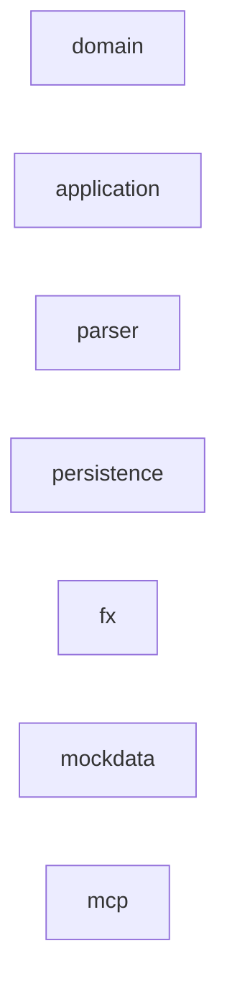

# Module dependencies

_Generated by graphify from actual `import` statements in main sources. Allowed direction:_
`mcp → adapters/application/domain, adapters → application → domain, mockdata → domain; adapters never → each other` _— never a cycle. A dotted `violates` edge is a HARD violation._

